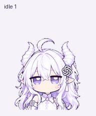

# GPT娘 Pets · GPT-Niang-Pets

基于 **[T7moris/GPT-Niang](https://github.com/T7moris/GPT-Niang)** 的第三方 Pets 动画适配。感谢 T7moris 和 GPT-Niang contributors 提供原项目与角色素材；本仓库不代表上游或 OpenAI 官方。素材完整来源与权利范围见 [ATTRIBUTION.md](ATTRIBUTION.md)。

## 下载和导入

1. 点击本仓库绿色 **Code → Download ZIP**，并完整解压；也可以使用 `git clone`。
2. 用 Codex 打开解压后的项目文件夹，安装并启用 **Pets** 插件。
3. 阅读下方的质量检查差异；打开 [INSTALL_PROMPT.md](INSTALL_PROMPT.md)，把提示词复制给 Codex。
4. Codex 应先验证 `pet/spritesheet.png`，然后创建你自己账号下的宠物并选中。无需重新生成素材。
5. 在支持 Pets 的桌面端用 `/pet` 或命令菜单“Show pet / 显示宠物”唤出；若列表没有刷新，进入设置中的 Pets 刷新并重新选择。

**环境要求：** 接收者自己的 Codex/ChatGPT 客户端和账号需要支持自定义 Pets，并提供 Pets 插件工具。本仓库不是可以直接双击安装的插件，也不能开启账号尚未提供的功能。云端 Pets 与本地客户端可能使用不同的宠物库；导入不等于所有客户端自动同步。仅想使用 Pets，无需运行 `upstream/` 里的独立额度挂件。

## 动作和显示

包含待机、向右移动、向左移动、挥手、跳跃、失败、等待、工作、查看，共9种状态，以及16个视线方向。具体触发由客户端调度，本仓库不提供“跳一下”等聊天控制指令。

每帧固定192×208像素，放大显示会降低清晰度；整图1536×2288包含全部帧，不代表单帧分辨率。

这是基于 [T7moris/GPT-Niang](https://github.com/T7moris/GPT-Niang) 角色形象制作的 Pets 动画适配项目。包含可导入的现成精灵图、9种状态动画、16个视线方向、预览、生成源图、验证记录，以及未修改的原项目 Windows 1.3.5 官方发行包。

## 给接收者的使用步骤

1. 完整解压本压缩包，用 Codex 打开解压后的文件夹。
2. 先查看 `previews/all-states.gif` 和 `previews/look-loop.gif`。
3. 安装并启用 Pets 插件。打开 `INSTALL_PROMPT.md`，阅读后把提示词复制给 Codex。导入需要该账号和客户端能够使用自定义 Pets 工具；仅解压文件不会自动安装。
4. 导入后在设置的 Pets 列表中选择 GPT娘；桌面端可通过 `/pet` 或“显示宠物”唤出。若该界面与云端宠物库不同步，需要使用该客户端支持的导入入口。没有对应功能时，保留文件并报告限制，不写入猜测的系统目录。

导入会在接收者账号下创建独立宠物记录。包内没有创建者的宠物 ID，也不需要创建者的登录信息。

## 文件说明

- `pet/spritesheet.png`：透明 v2 PNG，1536×2288；8列11行，每帧192×208。不是单张高清立绘。
- `manifest.json`：名称、描述、行定义、精灵图校验值。
- `previews/`：各状态GIF、全部状态MP4、跳跃衔接、视线循环和静态对照图。
- `sources/`：原角色参考和本次选用的生成条带，供后续调整使用。
- `qa/`：历史验证记录。绝对本机路径已替换；原始通过/失败结果未改写。这些是随包快照，不代替接收者导入时重新执行官方验证。
- `upstream/`：原项目未修改的官方 Windows 1.3.5 ZIP。仅需 Pets 的用户不用安装它；需要额度查询等原版功能时，另行解压并按上游 README 安装。它不是本次动画适配的安装器。macOS 用户请从上游下载对应版本。
- `notices/`：上游许可、角色素材声明和来源说明。
- `SHA256SUMS.txt`：包内所有其他文件的SHA256。

## 已知质量检查差异

官方 Pets 格式验证 `valid=true`；本地精灵图、标准动画帧、方向盲审通过。综合质量报告 `qa/pet-quality.json` 仍为 `ok=false`：部分视线帧中龙角、头发与呆毛之间的自然透明空隙被标为透明破洞/接缝。原制作者人工检查后保留了这些空隙，原用户明确同意仅豁免这一项后导入。部分中间视线方向还保留了已审阅的细微差异警告。接收者应自行查看预览并决定是否接受，不应将该历史授权视为自己的确认，也不应把失败报告改写为通过。

Pets 的动作调度由客户端控制，本包不增加逐个动作的聊天口令，也不突破每帧192×208的分辨率上限。

## 来源和许可

原项目： https://github.com/T7moris/GPT-Niang

官方版本：1.3.5 Windows。发行包SHA256：`ecd6a83c63727a104c4fb70756413d6c55fd50e421f41c2715beecf465fc9272`。

上游代码和文档采用 MIT；角色图片及其衍生图不在 MIT 授权范围内。请阅读 `notices/CHARACTER-NOTICE.txt` 和创作来源说明。本包按原项目的非商业项目展示/挂件适配用途整理，不能据此宣称拥有角色设计权、商用授权或独立素材包分发授权。转发时应保留完整原项目、来源和声明；请勿拆售素材。

本包未收录账号配置、额度数据、运行状态、聊天记录、个人安装补丁、创建者宠物ID、上传会话或临时下载链接。
